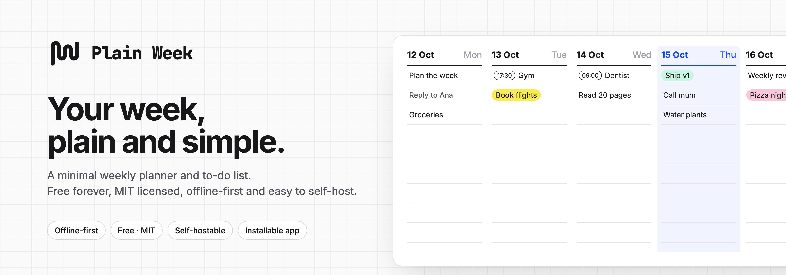
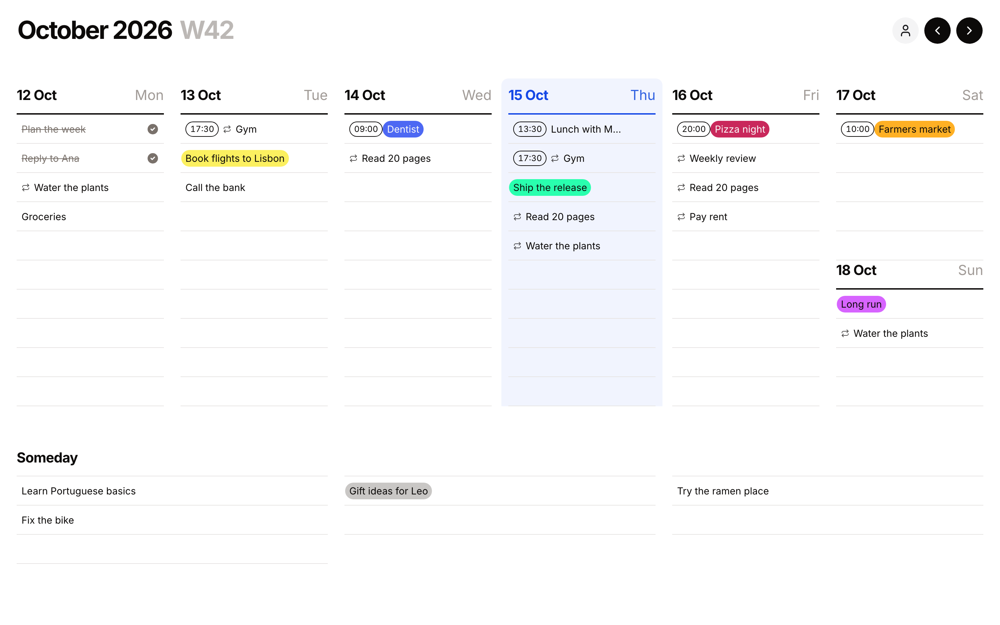
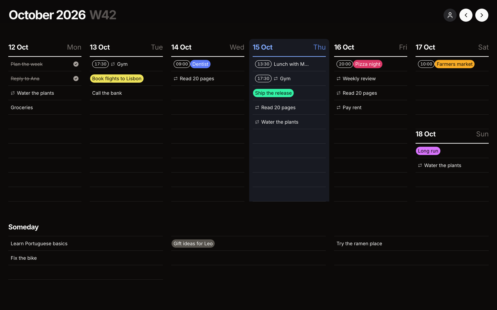
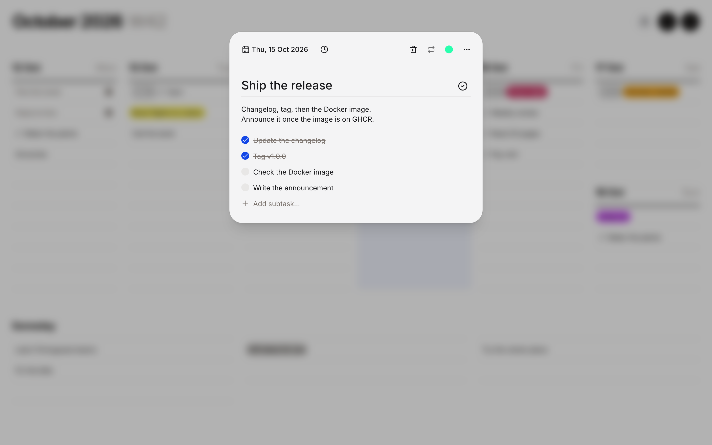
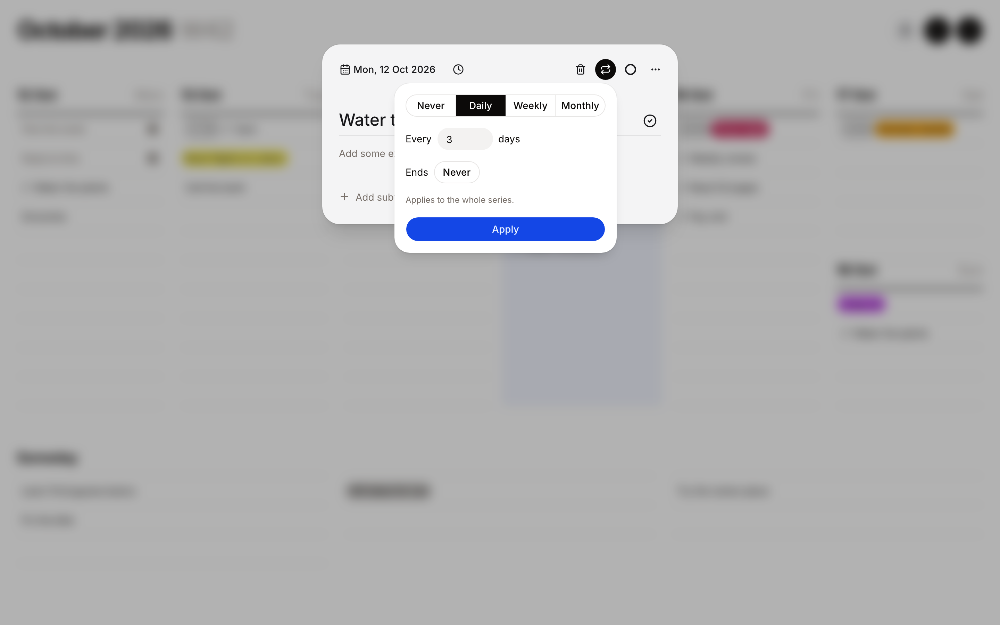
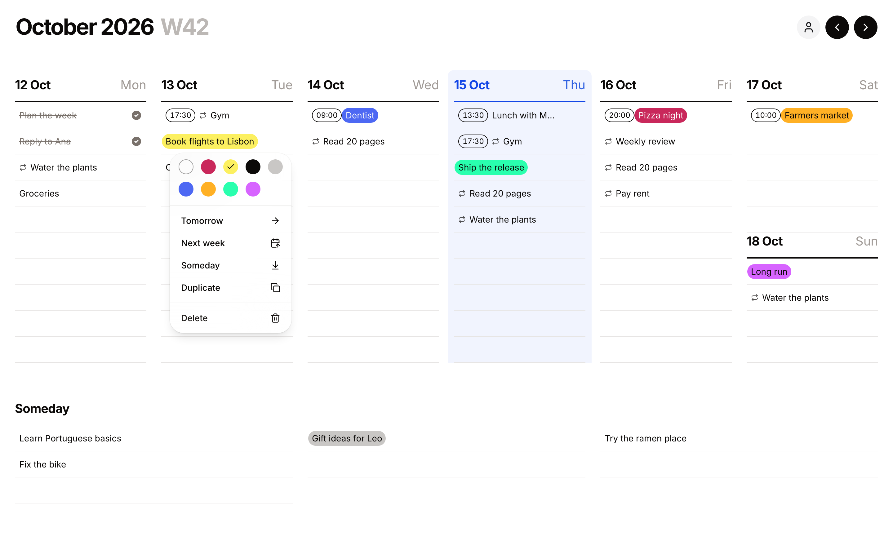
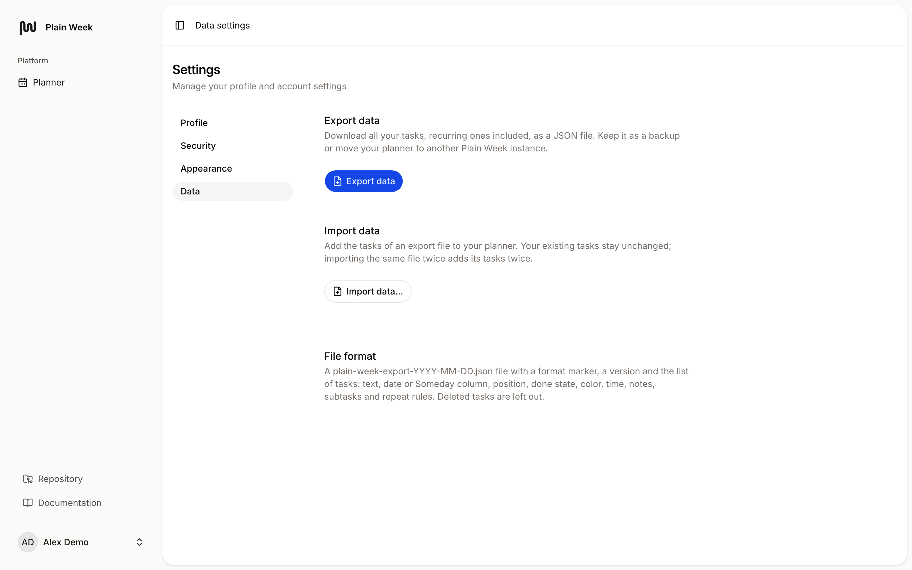
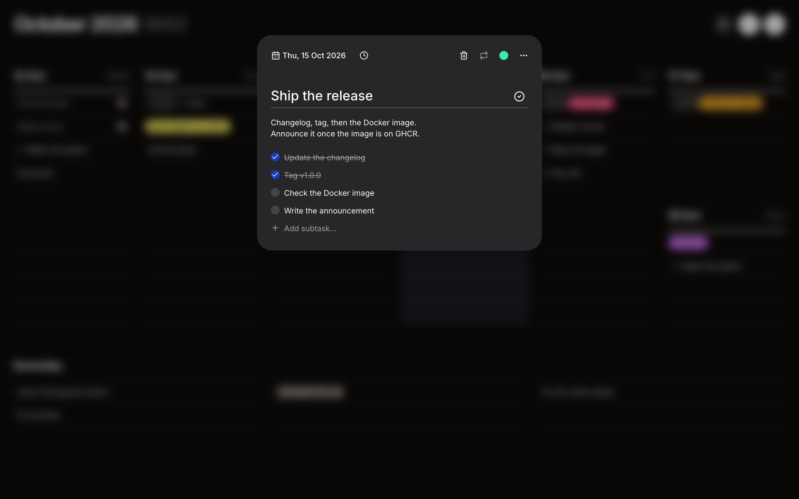
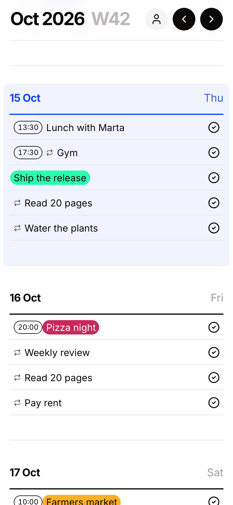
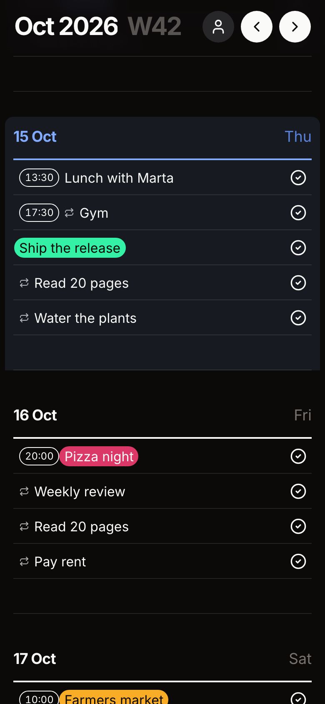

<p align="center">
  <picture>
    <source media="(prefers-color-scheme: dark)" srcset="./docs/images/header-dark.png">
    <source media="(prefers-color-scheme: light)" srcset="./docs/images/header-light.png">
    
  </picture>
</p>

<h1 align="center">Plain Week</h1>

<p align="center">
  <strong>Your week, plain and simple.</strong><br>
  A minimal weekly planner and to-do list that works offline, syncs if you want it to, and runs on your own server.
</p>

<p align="center">
  <a href="./LICENSE"></a>
  <a href="https://github.com/victor-falcon/plain-week/releases/latest"></a>
  <a href="https://github.com/victor-falcon/plain-week/actions/workflows/tests.yml"></a>
  <a href="https://github.com/victor-falcon/plain-week/pkgs/container/plain-week"></a>
</p>

- **One week, one screen.** A column per day and a Someday list for everything without a date. Nothing else.
- **Instant, even offline.** Your planner lives in your browser, so it opens and saves without waiting on a server.
- **Yours.** Free forever, MIT licensed, no premium tier, no tracking. Use it without an account or host it yourself.



## Features

- **Fast entry.** Click an empty row, type, press Enter, keep typing. "17:30 Gym" sets the time for you.
- **Recurring tasks.** Repeat every N days, weekly on any weekdays or monthly on a day, with an optional end date.
  Change or move one occurrence, or this and all the following ones.
- **Colors, notes and subtasks.** Eight colors, plain-text notes and a checklist, all in one task dialog.
- **Drag and drop.** Reorder within a day, move across days and to Someday, or drop on the screen edge to send a task to
  another week. Mouse, touch and keyboard.
- **Right click for the rest.** A context menu to color, duplicate, delete or move a task to tomorrow, next week or
  Someday, with undo.
- **Keyboard shortcuts.** ← / → to change weeks, T to jump back to today.
- **Offline-first and installable.** Data lives in IndexedDB; the app loads and works without a connection and installs
  as an app (PWA).
- **Optional account and sync.** Start as a guest, fully local. Create an account to sync between devices; your local
  work comes with you.
- **Export and import.** With an account, download all your tasks as JSON from Settings › Data and bring them back on
  any instance.
- **Light and dark mode, right-to-left layouts.**
- **Self-hosting in one container.** A Docker image on GHCR, a one-click Coolify template, SQLite and no other
  services.

| Dark mode                                                     | Task dialog                                        |
| ------------------------------------------------------------- | -------------------------------------------------- |
|  |  |

| Repeat every N days                                             | Right-click menu                                               |
| --------------------------------------------------------------- | -------------------------------------------------------------- |
|  |  |

| Export and import                                                            | Task dialog, dark                                              |
| ---------------------------------------------------------------------------- | -------------------------------------------------------------- |
|  |  |

| Phone, light                                                              | Phone, dark                                                             |
| ------------------------------------------------------------------------- | ----------------------------------------------------------------------- |
|  |  |

## Local development

Requirements: PHP 8.3+ (8.5 recommended), Composer, bun 1.3+, and Node.js 24+.

```sh
git clone https://github.com/victor-falcon/plain-week.git
cd plain-week
composer setup      # install dependencies, create .env, generate key, migrate SQLite, build assets
composer run dev    # serve the app, queue worker, logs and Vite
```

Then open http://127.0.0.1:8000.

Before pushing, run what CI runs:

```sh
composer ci:check   # JS lint/format, TS types, JS tests, Pint, PHPStan, Pest
bun run build       # production assets
```

## Self-hosting

One container, SQLite on a volume, no other services:

```sh
docker run -d -p 127.0.0.1:8080:8080 -v plainweek-storage:/app/storage \
  -e APP_KEY="base64:$(openssl rand -base64 32)" ghcr.io/victor-falcon/plain-week:latest
```

There is a one-click [Coolify](https://coolify.io) template, a `docker-compose.yml` for any server and a guide for
running it without Docker: see [docs/self-hosting.md](./docs/self-hosting.md).

## Documentation

See [docs/](./docs/README.md) for the architecture (offline-first and the sync contract), the style guide, the stack
and the conventions, and [CHANGELOG.md](./CHANGELOG.md) for what changed in each release.

## License

[MIT](./LICENSE)
